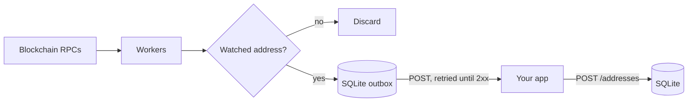

<div align="center">

# Multi-Chain Transaction Indexer

**Detect deposits to your addresses across 14 blockchains in real time.**


</div>

The indexer reads every block from your RPC nodes, keeps the transfers that touch your watched addresses, and POSTs them to your webhook. It is **one static Go binary with one SQLite file**: no message queue, database server or cache to run.



- **Workers**: `regular` follows the chain head (with reorg rollback on EVM and Bitcoin), `catchup` fills gaps, `rescanner` retries failed blocks, `manual` re-indexes ranges you queue, and `mempool` reports 0-conf Bitcoin transactions.
- **Restart-safe**: progress and undelivered events live in SQLite, so a crash or restart resumes where it stopped.
- **At-least-once delivery**: an event is deleted only after your webhook returns `2xx`.

## Supported chains

| Type | Chains |
| --- | --- |
| `evm` | Ethereum, BSC, Polygon, Arbitrum, Optimism and other EVM chains (stable) |
| `tron` | TRON (stable) |
| `btc` | Bitcoin (stable) |
| `sol`, `apt`, `sui`, `cosmos`, `ton`, `xrp`, `stellar` | Solana, Aptos, Sui, Cosmos Hub / Osmosis / Celestia, TON, XRP Ledger, Stellar (beta) |

## Deploy

### 1. Configure

```bash
cp configs/config.example.yaml configs/config.yaml
```

In `configs/config.yaml`, set `enabled: true` and your RPC `nodes` for each chain you want, then fill in `services`:

```yaml
services:
  port: 8080                      # /health, /status and the admin API
  db_path: "data/indexer.db"      # all state lives here
  webhook:
    url: "https://your-app.example.com/indexer/events"
    secret: "long-random-string"  # signs every request (recommended)
  api_token: "another-random-string" # required for POST /addresses; empty disables the admin API
  worker:
    regular:   { enabled: true }
    catchup:   { enabled: true }  # keep on: fills blocks missed while the indexer was down
    rescanner: { enabled: true }
    manual:    { enabled: false }
    mempool:   { enabled: false } # Bitcoin 0-conf only
```

Any key present in the file can be overridden by an environment variable named after its path, e.g. `SERVICES_API_TOKEN` or `SERVICES_WEBHOOK_SECRET`. Use this for secrets. `${VAR}` placeholders inside the YAML are **not** expanded.

### 2a. Run with Docker

The image runs as non-root user `65532`, so the mounted data and log directories must be writable by it.

```bash
mkdir -p data logs && sudo chown 65532:65532 data logs
CHAINS=ethereum_mainnet,tron_mainnet docker compose -f docker-compose.indexer.yml up -d --build
```

`docker-compose.indexer.yml` mounts `./configs` (read-only), `./data` and `./logs`, uses host networking, and starts with `--catchup --manual --debug`. Edit its `command` to change the flags.

If the logs show `Open SQLite failed ... unable to open database file`, the `data` directory is not writable by user `65532`.

### 2b. Run the binary

```bash
CGO_ENABLED=0 go build -o indexer ./cmd/indexer   # Go 1.25+
./indexer index --chains=ethereum_mainnet,tron_mainnet --catchup
```

As a systemd service:

```ini
# /etc/systemd/system/indexer.service
[Service]
WorkingDirectory=/opt/indexer
ExecStart=/opt/indexer/indexer index -c configs/config.yaml --catchup
Environment=SERVICES_API_TOKEN=change-me
Restart=always
User=indexer

[Install]
WantedBy=multi-user.target
```

| Flag | Meaning |
| --- | --- |
| `-c, --config` | Config path (default `configs/config.yaml`) |
| `-n, --chains` | Comma-separated chain names from the config; default: all enabled chains |
| `--catchup` / `--manual` | Enable those workers (overrides config) |
| `--from-latest` | Start from the chain head instead of `start_block` |
| `-d, --debug` | Debug logging |

### 3. Register addresses

```bash
curl -X POST localhost:8080/addresses -H "Authorization: Bearer $TOKEN" \
  -d '{"type":"evm","addresses":["0x5aAeb6053F3E94C9b9A09f33669435E7Ef1BeAed"]}'
```

- `type` is the chain type from the table above. Up to 10,000 addresses per call; they take effect immediately.
- Matching is exact and **case-sensitive**: send addresses in the form the chain reports them.

To re-index a block range (needs the manual worker):

```bash
curl -X POST localhost:8080/manual-ranges -H "Authorization: Bearer $TOKEN" \
  -d '{"chain":"ethereum_mainnet","start":21500000,"end":21500100}'
```

Both endpoints return `204` on success and `400` with a reason on bad input.

### 4. Monitor

- `GET /health` returns `{"status":"ok"}` while the process is up.
- `GET /status` shows each chain's head, indexed block, lag, failed blocks and catchup ranges.

## Receiving events

Each matched transfer is POSTed to `webhook.url` as one JSON object:

```json
{
  "txHash": "0x8a5c…3e3f",
  "networkId": "ethereum_mainnet",
  "blockNumber": 21500150,
  "blockHash": "0x1f9e…77ab",
  "fromAddress": "0x742d35Cc6634C0532925a3b844Bc9e7595f2bD18",
  "toAddress": "0x5aAeb6053F3E94C9b9A09f33669435E7Ef1BeAed",
  "assetAddress": "",
  "amount": "1500000000000000000",
  "type": "native_transfer",
  "txFee": "0.000315",
  "timestamp": 1704067200,
  "confirmations": 12,
  "status": "confirmed",
  "direction": "in"
}
```

`amount` is in the smallest unit (wei, sun, lamports…). `assetAddress` is the token contract, or empty for native transfers. Some chains add `memo`, `destinationTag` or `metadata`.

| Header | Use |
| --- | --- |
| `X-Event-Type` | `transfer`, or `utxo` for Bitcoin UTXO events (`index_utxo: true`) |
| `Idempotency-Key` | Stable event ID. Delivery is at-least-once: dedupe on it |
| `X-Signature-256` | `sha256=` + hex HMAC-SHA256 of the raw body with `webhook.secret`. Reject on mismatch |

Delivery is in order. A non-`2xx` response or a 10s timeout is retried with backoff (1s up to 1m), and later events wait behind it, so a broken endpoint delays events but never drops them.

Return `2xx` only after the event is stored, and check that `toAddress` is one of yours before crediting. If an address lookup itself fails (e.g. a disk error), the indexer treats it as a match rather than risk missing a deposit.

## Operations

- **State** is `data/indexer.db` plus its `-wal` and `-shm` files. Back up with `sqlite3 data/indexer.db ".backup backup.db"`, or copy all three files while the indexer is stopped.
- **Downtime**: on restart the missed blocks are queued as catchup ranges. They are only indexed when the catchup worker is enabled.
- **Upgrading from the NATS / Postgres / Redis version**: the `nats`, `database`, `redis`, `kvstore` and `bloomfilter` config sections are gone. Addresses and progress are not migrated: register addresses through `POST /addresses`, and switch consumers from NATS to the webhook.

## Contributing

See [CONTRIBUTING.md](CONTRIBUTING.md). Run `go test ./... -short -race` before opening a pull request.

## License

MIT. See [LICENSE](LICENSE).
