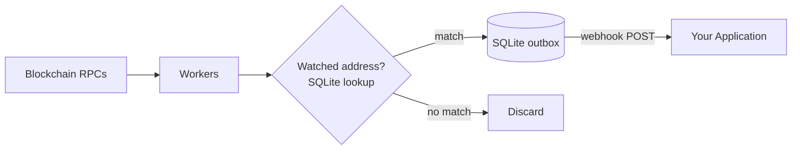
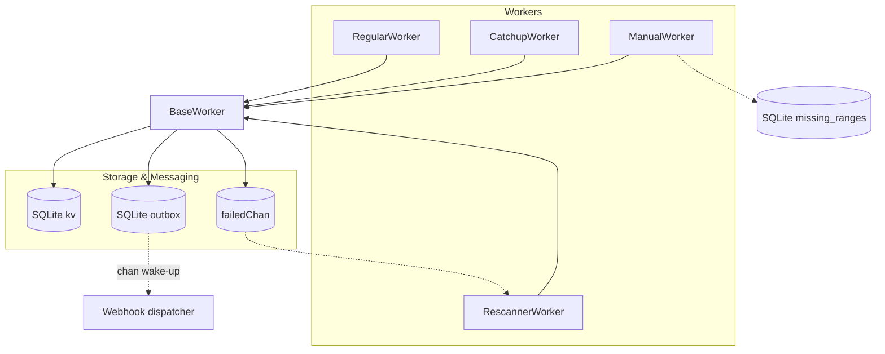

<div align="center">

# Multi-Chain Transaction Indexer

**Detect deposits to your addresses across 12+ blockchains in real time.**

A production-ready indexer that parses every on-chain transaction, matches destination addresses against your watched list, and POSTs matched transfers to your webhook. One Go binary with an embedded SQLite file — no NATS, Postgres, Redis or Consul to run.


</div>

---

## Use Cases

- **Crypto Payment Gateways** — Detect incoming payments to merchant deposit addresses in real time across multiple chains. Automatically trigger order fulfillment or payment confirmation when funds arrive.
- **Centralized Exchanges (CEX)** — Monitor deposit addresses for incoming user funds. Identify and credit deposits across all supported chains without running separate infrastructure per network.
- **OTC Desks** — Track settlement addresses to confirm large transfers have landed on-chain. Get instant notifications when counterparty funds arrive at designated addresses.

## Key Features

- **14+ Chains** — Ethereum, BSC, TRON, Polygon, Arbitrum, Optimism, Bitcoin, Solana, Aptos, Sui, Cosmos, TON, XRP, Stellar
- **Real-time + Historical** — Four cooperating workers cover live blocks, gap backfill, failed retries, and manual rescans
- **Exact Address Matching** — Indexed SQLite lookups: no false positives, new addresses count immediately, addresses stay on disk instead of RAM
- **Webhook Events** — Matched transactions are written to an outbox, then POSTed in order with retry until your app acknowledges them
- **RPC Failover** — Automatic failover across multiple providers with rate limiting and exponential backoff
- **Restart-Safe** — Progress and undelivered events persisted to SQLite; pick up exactly where you left off
- **Single Binary** — One static Go binary (no CGO) indexes all chains concurrently; no external services needed

## Architecture




<details>
<summary>Detailed worker architecture</summary>



</details>

## Performance

| Metric | Value |
| --- | --- |
| Address lookup (SQLite primary key) | microseconds per check, exact |
| Concurrent chains | Limited only by RPC capacity |
| Memory footprint | ~25 MB RSS measured with one chain; addresses live on disk |
| Recovery time | Instant — resumes from last persisted block |

## Why This Indexer?

| | This Indexer | The Graph | Alchemy Webhooks | Custom RPC Polling |
| --- | --- | --- | --- | --- |
| Self-hosted | Yes | Requires subgraph infra | No (SaaS) | Yes |
| Multi-chain in one binary | 12+ chains | Per-subgraph | Per-webhook | Manual per chain |
| Address filtering | Exact SQLite lookup (millions of addrs) | GraphQL queries | Webhook filters | Custom logic |
| Historical backfill | Built-in (catchup + manual workers) | Re-index subgraph | Limited | Manual |
| Latency | Block time (~1-12s) | Minutes (indexing delay) | Seconds | Block time |
| Cost | Infra only | Hosted fees or infra | Per-event pricing | Infra only |
| Non-EVM support | BTC, SOL, TRON, Aptos, Sui, Cosmos, TON, XRP, Stellar | EVM only | EVM only | Per-chain effort |

## Supported Chains

| Chain | Type | Status |
| --- | --- | --- |
| Ethereum | EVM | Stable |
| BSC | EVM | Stable |
| Polygon | EVM | Stable |
| Arbitrum | EVM | Stable |
| Optimism | EVM | Stable |
| TRON | TRON | Stable |
| Bitcoin | UTXO | Stable |
| Solana | SVM | Beta |
| Aptos | Move | Beta |
| Sui | Move | Beta |
| Cosmos (Hub, Osmosis, Celestia) | Cosmos | Beta |
| TON | TON | Beta |
| XRP | XRP Ledger | Beta |
| Stellar | Stellar | Beta |

---

## Table of Contents

- [Quick Start](#-quick-start)
- [Worker Logic](#%EF%B8%8F-worker-logic)
- [Storage](#%EF%B8%8F-storage)
- [Admin API](#-admin-api)
- [Configuration](#-configuration)
- [Usage Highlights](#-usage-highlights)
- [Consuming Transaction Events](#-consuming-transaction-events)
- [Contributing](#contributing)
- [License](#license)

---

**Logic Flow:**

1. **RegularWorker**: real-time indexing, reorg handling, error reporting
2. **CatchupWorker**: backfills gaps, tracks progress, cleans up ranges
3. **ManualWorker**: backfills ranges queued via `POST /manual-ranges`
4. **RescannerWorker**: retries failed blocks, updates KV on success

---

## Quick Start

```bash
git clone https://github.com/fystack/multichain-indexer.git
cd transaction-indexer
go mod download
cp configs/config.example.yaml configs/config.yaml
CGO_ENABLED=0 go build -o indexer ./cmd/indexer

# Index EVM & TRON in real-time
./indexer index --chains=ethereum_mainnet,tron_mainnet

# Add catchup worker for historical gaps
./indexer index --chains=ethereum_mainnet,tron_mainnet --catchup

# Add manual worker for missing blocks
./indexer index --chains=ethereum_mainnet,tron_mainnet --manual

# Watch an address (needs services.api_token in config.yaml)
curl -X POST localhost:8080/addresses -H "Authorization: Bearer $TOKEN" \
  -d '{"type":"evm","addresses":["0x5aAeb6053F3E94C9b9A09f33669435E7Ef1BeAed"]}'

# For help
./indexer --help
```

---

## ⚙️ Worker Logic

### **BaseWorker**

- Shared logic for all worker types
- Rate limiting, logging, address matching, KV store integration
- Sends error blocks to `failedChan` and stores in `<chain>/failed_blocks/<block>`

---

### **RegularWorker**

- Continuously processes latest blocks from RPC
- Saves progress to `<chain>/latest_block`
- For EVM, handle reorgs with rollback window
- On block failure → BaseWorker stores it for retry

---

### **CatchupWorker**

- Processes historical blocks in ranges `[start,end]`
- Uses KV `<chain>/catchup_progress/<start>-<end>` to track progress
- Deletes the key when a range is completed
- Integrates failed blocks from Rescanner

---

### **ManualWorker**

- Handles **explicit missing blocks** (due to RPC errors, reorg skips, or manual intervention).
- Ranges are queued with `POST /manual-ranges` and stored in the SQLite `missing_ranges` table
  - Overlapping or adjacent ranges are merged, then split into 5-block chunks for finer retries
- Workflow:

  1. Claim the lowest unclaimed range (`GetNextRange`); the claim lasts `RangeProcessingTimeout`
  2. Process all blocks in `[start,end]`
  3. On full success → `RemoveRange`
  4. On partial failure → the claim expires and the range is retried

---

### **RescannerWorker**

- Re-processes failed blocks from KV `<chain>/failed_blocks/<block>` or `failedChan`
- Updates KV when retry succeeds
- Removes blocks after max retry attempts
- Skips chain head block to reduce reorg risk

---

## 🗝️ Storage

All state lives in one SQLite file (`services.db_path`, default `data/indexer.db`):

| Table / key | Purpose |
| --- | --- |
| `kv` → `block_states/<chain>/latest_block` | RegularWorker progress |
| `kv` → `block_states/<chain>/catchup_progress/<start>-<end>` | CatchupWorker progress per range |
| `kv` → `block_states/<chain>/failed_blocks` | Failed blocks for retry |
| `wallet_addresses` | Watched addresses, keyed by `(type, address)` |
| `missing_ranges` | ManualWorker queue |
| `outbox` | Matched events not yet acknowledged by the webhook |

Back it up by copying the file while the indexer is stopped, or with `sqlite3 indexer.db ".backup copy.db"` while running.

---

## 🔌 Admin API

Served on `services.port` next to `/health` and `/status`. Both endpoints need `Authorization: Bearer <services.api_token>`; with no token configured they are disabled.

```bash
# Watch addresses (type: evm, tron, btc, sol, apt, sui, cosmos, ton, xrp, stellar). Up to 10,000 per call.
# Matching is exact and case-sensitive: send addresses in the form the chain reports them.
curl -X POST localhost:8080/addresses -H "Authorization: Bearer $TOKEN" \
  -d '{"type":"tron","addresses":["TAWdqnuYCNU3dKsi7pR8d7sDkx1Evb2giV"]}'

# Queue a block range for the manual worker (run with --manual). Up to 100,000 blocks per call.
curl -X POST localhost:8080/manual-ranges -H "Authorization: Bearer $TOKEN" \
  -d '{"chain":"ethereum_mainnet","start":21500000,"end":21500100}'
```

Both return `204` on success and `400` with a reason on bad input.

---

## 🔧 Configuration

- **Chains**: configurable (`start_block`, `batch_size`, `poll_interval`)
- **Storage**: one SQLite file (`services.db_path`)
- **Events**: webhook (`services.webhook.url`, optional `secret` for HMAC signing)
- **Admin API**: `services.api_token`
- **RPC Providers**: failover + rate-limiting

See `configs/config.example.yaml` for details.

---

## 🏗️ Core Principles

- **Multi-chain support**: independent workers per chain
- **Auto-catchup**: detect gaps → backfill → cleanup
- **Failed block recovery**: persisted + retryable
- **Manual backfill**: ranges queued over the admin API
- **State persistence**: SQLite (progress + outbox) → restart-safe, events survive crashes

---

## ⚡ Usage Highlights

The chain names passed to `--chains` **must match the names defined in `configs/config.yaml`**.
Example: `ethereum_mainnet`, `tron_mainnet`.

```bash
# Real-time only
./indexer index --chains=ethereum_mainnet,tron_mainnet

# Real-time + catchup (fill historical gaps)
./indexer index --chains=ethereum_mainnet,tron_mainnet --catchup

# Add manual worker to process ranges queued via POST /manual-ranges
./indexer index --chains=ethereum_mainnet,tron_mainnet --manual

# Debug mode (extra logs)
./indexer index --chains=ethereum_mainnet,tron_mainnet --debug

```

---

## 📝 Example `configs/config.yaml` (chains section)

```yaml
chains:
  ethereum_mainnet: # <- this is the chain name
    type: "evm"
    nodes:
      - url: "https://eth-mainnet.g.alchemy.com/v2/${API_KEY}"
        auth:
          type: "header"
          key: "Authorization"
          value: "Bearer ${API_KEY}"
      - url: "https://rpc.ankr.com/eth"
    start_block: 21500000
    poll_interval: "6s"
    client:
      timeout: "20s"
      max_retries: 3
      retry_delay: "5s"
      throttle:
        rps: 8
        burst: 16

  tron_mainnet:
    type: "tron"
    nodes:
      - url: "https://api.trongrid.io"
        auth:
          type: "header"
          key: "TRON-PRO-API-KEY"
          value: "${TRON_API_KEY}"
      - url: "https://tron-rpc.publicnode.com"
    start_block: 75144237
    poll_interval: "8s"
    client:
      timeout: "20s"
      max_retries: 5
      retry_delay: "10s"
      throttle:
        rps: 5
        burst: 8

  cosmoshub_mainnet:
    type: "cosmos"
    network_id: "cosmoshub-4"
    native_denom: "uatom"
    nodes:
      - url: "https://rpc.cosmos.directory/cosmoshub"
      - url: "https://cosmos-rpc.publicnode.com"
    poll_interval: "5s"
    client:
      timeout: "20s"
      max_retries: 3
      retry_delay: "2s"
    throttle:
      rps: 20
      burst: 40
```

## 📡 Consuming Transaction Events

Matched events are POSTed to `services.webhook.url`, one event per request, as JSON:

| Header | Value |
| --- | --- |
| `X-Event-Type` | `transfer` or `utxo` |
| `Idempotency-Key` | Stable event ID. Delivery is at-least-once, so dedupe on it |
| `X-Signature-256` | `sha256=<hex HMAC-SHA256 of the body>`, when `webhook.secret` is set |

Delivery is in order. A non-`2xx` response or timeout (10s) is retried with backoff (1s → 1m) until it succeeds, and later events wait behind it, so a broken endpoint stalls delivery rather than dropping deposits. Undelivered events stay in the `outbox` table across restarts.

### Sample Transfer Events

Each webhook request body is a single transaction serialized as JSON.

**EVM Native Transfer (ETH):**

```json
{
  "txHash": "0x8a5c1b3e9f2d4a6b7c0e1f3d5a7b9c2e4f6a8d0b3c5e7f9a1b3d5f7a9c1e3f",
  "networkId": "ethereum_mainnet",
  "blockNumber": 21500150,
  "fromAddress": "0x742d35Cc6634C0532925a3b844Bc9e7595f2bD18",
  "toAddress": "0x5aAeb6053F3E94C9b9A09f33669435E7Ef1BeAed",
  "assetAddress": "",
  "amount": "1500000000000000000",
  "type": "native_transfer",
  "txFee": "0.000315",
  "timestamp": 1704067200
}
```

**EVM Token Transfer (ERC-20 USDT):**

```json
{
  "txHash": "0x1b2c3d4e5f6a7b8c9d0e1f2a3b4c5d6e7f8a9b0c1d2e3f4a5b6c7d8e9f0a1b",
  "networkId": "ethereum_mainnet",
  "blockNumber": 21500200,
  "fromAddress": "0xA1b2C3d4E5f6789abcdef0123456789ABCDEF01",
  "toAddress": "0xF1e2D3c4B5a6978654321fedcba9876543210FED",
  "assetAddress": "0xdAC17F958D2ee523a2206206994597C13D831ec7",
  "amount": "50000000",
  "type": "token_transfer",
  "txFee": "0.00042",
  "timestamp": 1704067800
}
```

**TRON Native Transfer (TRX):**

```json
{
  "txHash": "a1b2c3d4e5f6a7b8c9d0e1f2a3b4c5d6e7f8a9b0c1d2e3f4a5b6c7d8e9f0a1b2",
  "networkId": "tron_mainnet",
  "blockNumber": 75144300,
  "fromAddress": "TJYeasTPa3GwE8Rrk2DLJ9RVmPEBsXcZnH",
  "toAddress": "TVj35JkE8NNohMGjhYhD47Rk3KLBQvSfbx",
  "assetAddress": "",
  "amount": "10000000",
  "type": "native_transfer",
  "txFee": "1.1",
  "timestamp": 1704068400
}
```

**Solana Token Transfer (SPL USDC):**

```json
{
  "txHash": "5KtPn1LGuxhFiwjxErkxTb5dTmJmx8bLmQrXUpwZhfJzNFyRHNLFpA8yrJcdminZ",
  "networkId": "solana_mainnet",
  "blockNumber": 312000500,
  "fromAddress": "9WzDXwBbmkg8ZTbNMqUxvQRAyrZzDsGYdLVL9zYtAWWM",
  "toAddress": "7xKXtg2CW87d97TXJSDpbD5jBkheTqA83TZRuJosgAsU",
  "assetAddress": "EPjFWdd5AufqSSqeM2qN1xzybapC8G4wEGGkZwyTDt1v",
  "amount": "1000000",
  "type": "token_transfer",
  "txFee": "0.000005",
  "timestamp": 1704069000
}
```

**Sui Native Transfer (SUI):**

```json
{
  "txHash": "3Fz8wLkMnPqRsT2uVxY4zA1bC5dE7fG9hI0jK3lM5nO",
  "networkId": "sui_mainnet",
  "blockNumber": 48500100,
  "fromAddress": "0x1a2b3c4d5e6f7890abcdef1234567890abcdef1234567890abcdef1234567890",
  "toAddress": "0xfedcba0987654321fedcba0987654321fedcba0987654321fedcba0987654321",
  "assetAddress": "0x2::sui::SUI",
  "amount": "2000000000",
  "type": "native_transfer",
  "txFee": "0.001",
  "timestamp": 1704069600
}
```

**Bitcoin Native Transfer (BTC):**

```json
{
  "txHash": "a1b2c3d4e5f6a7b8c9d0e1f2a3b4c5d6e7f8a9b0c1d2e3f4a5b6c7d8e9f0a1b2",
  "networkId": "bitcoin_mainnet",
  "blockNumber": 850100,
  "fromAddress": "bc1qxy2kgdygjrsqtzq2n0yrf2493p83kkfjhx0wlh",
  "toAddress": "bc1q9h5yjqka3g4fs3pwfmwqf5ye9h6ynxz0s7ywyx",
  "assetAddress": "",
  "amount": "50000",
  "type": "native_transfer",
  "txFee": "0.00001234",
  "timestamp": 1704070200
}
```

**Field Reference:**

| Field | Description |
| --- | --- |
| `txHash` | Transaction hash |
| `networkId` | Chain identifier matching config name |
| `blockNumber` | Block height (0 for mempool) |
| `fromAddress` | Sender address |
| `toAddress` | Recipient address |
| `assetAddress` | Token contract address (empty for native transfers) |
| `amount` | Transfer amount in smallest unit (wei, sun, lamports, etc.) |
| `type` | `native_transfer` or `token_transfer` |
| `txFee` | Transaction fee in native token |
| `timestamp` | Unix timestamp |

### Important: Event Verification

> Address matching is exact, but if the address lookup itself fails (for example a disk error), the indexer treats the transaction as a match rather than risk missing a deposit. **Always verify that `toAddress` exists in your system and check `X-Signature-256` before crediting your ledger.**

### Go Webhook Receiver

```go
package main

import (
    "crypto/hmac"
    "crypto/sha256"
    "encoding/hex"
    "io"
    "log"
    "net/http"
)

const secret = "change-me" // services.webhook.secret

func main() {
    http.HandleFunc("/indexer/events", func(w http.ResponseWriter, r *http.Request) {
        body, _ := io.ReadAll(r.Body)
        mac := hmac.New(sha256.New, []byte(secret))
        mac.Write(body)
        want := "sha256=" + hex.EncodeToString(mac.Sum(nil))
        if !hmac.Equal([]byte(want), []byte(r.Header.Get("X-Signature-256"))) {
            http.Error(w, "bad signature", http.StatusUnauthorized)
            return
        }
        // Dedupe on Idempotency-Key, then process. Return 2xx only once it is stored.
        log.Printf("%s %s: %s", r.Header.Get("X-Event-Type"), r.Header.Get("Idempotency-Key"), body)
        w.WriteHeader(http.StatusNoContent)
    })
    log.Fatal(http.ListenAndServe(":3000", nil))
}
```

---

## Contributing

Contributions are welcome! Please see [CONTRIBUTING.md](CONTRIBUTING.md) for guidelines.

1. Fork the repository
2. Create your feature branch (`git checkout -b feat/my-feature`)
3. Commit your changes (`git commit -m 'feat: add my feature'`)
4. Push to the branch (`git push origin feat/my-feature`)
5. Open a Pull Request

## License

This project is licensed under the MIT License. See [LICENSE](LICENSE) for details.
